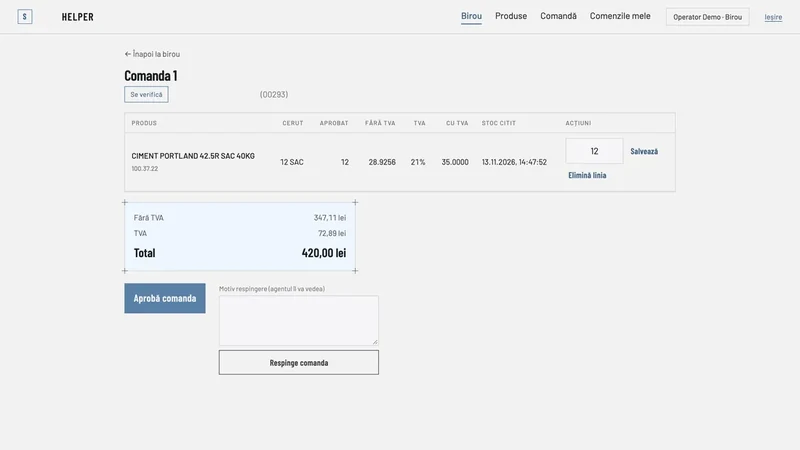

# Darius Șerban

I graduated in Computer Science from the Petroleum-Gas University of Ploiești, Romania, in 2026. I build web applications and run them on my own Linux server.

My portfolio, [plainsite.dev](https://plainsite.dev/en/), has a write-up of most projects on this page. You can reach me at serbdari98@gmail.com.

<table width="100%">
  <tr>
    <td align="center" width="50%">
      
       <b>Dayro Distribution website</b> Client work, live
    </td>
    <td align="center" width="50%">
      
       <b>LayerCure</b> Resin slicer in Rust, in progress
    </td>
  </tr>
  <tr>
    <td align="center" width="50%">
      
       <b>Workspace</b> Self-hosted tracker, in daily use
    </td>
    <td align="center" width="50%">
      
       <b>Ordering app for a field sales team</b> Client work, in beta, shown with demo data
    </td>
  </tr>
</table>

## Client work

Client repositories are private.

- **[Dayro Distribution website](https://dayrodistribution.com)**. I built a bilingual catalogue and quote-request site for a Romanian distributor of construction fixings. It lists 277 products in 1,680 variants and shows whether each one is in stock. I host it on my own Ubuntu server. My portfolio has the [write-up](https://plainsite.dev/en/projects/dayro-distribution-website/).
   Astro, React, TypeScript, Playwright, GitHub Actions
- **[Ordering app for a field sales team](https://plainsite.dev/en/projects/field-sales-ordering-app/)**. The app is in beta. Sales agents take orders on their phones. The office approves each order and exports it as XML for the accounting software. The app reads the accounting database and never writes to it.
   TypeScript, Fastify, SQLite, Firebird, Kotlin, Vitest
- **Platform for youth sports clubs**. Two of us are building it. It gives clubs, coaches and parents one system for teams, attendance, payments and invoices. It runs on the web and as Android and iOS apps.
   TypeScript, Express, Prisma, PostgreSQL, React, Capacitor

## My own projects

- **[dualspeakers](https://github.com/Fushi500/dualspeakers)**. It plays the same audio on two Windows outputs and keeps them aligned. I measured the offset with a microphone at the listening position. The median is -0.021 ms and the spread is 0.203 ms over five runs. It works but is not finished.
   C++20, WASAPI exclusive mode, CMake, 241 tests
- **[Workspace](https://plainsite.dev/en/projects/workspace/)**. It is a self-hosted tracker with pages, tables, boards, a command-line tool and an API. I use it every day. The repository is private.
   TypeScript, Fastify, React, PostgreSQL, Docker Compose
- **[LayerCure](https://plainsite.dev/en/projects/layercure/)**. It is a resin 3D-printing slicer with a desktop app. I am still building it.
   Rust
- **[Macro Micro](https://plainsite.dev/en/projects/macro-micro/)**. It is a nutrition and fitness tracker for Romania. Version 1 was the subject of my bachelor thesis and is now retired. I am building version 2 as an Android app.
   Version 1 ran on Flutter, Fastify, PostgreSQL, Redis, Meilisearch and Docker Compose
- **[nutrition-label-llm](https://github.com/Fushi500/nutrition-label-llm)**. It is a LoRA fine-tune of Qwen2.5-14B that turns OCR text from EU nutrition labels into JSON. The repository holds a synthetic dataset of 50,000 examples and the QLoRA training script.
   Python, Unsloth, TRL

Two smaller repositories are [exercises-api](https://github.com/Fushi500/exercises-api), which serves 872 exercises as static JSON on GitHub Pages, and [tourism-db](https://github.com/Fushi500/tourism-db), a MariaDB schema from my coursework.

## What I work with

<table width="100%">
  <tr>
    <td>
      <b>Languages</b> 
      
      
      
      
      
      
    </td>
  </tr>
  <tr>
    <td>
      <b>Web and apps</b> 
      
      
      
      
      
      
      
      
    </td>
  </tr>
  <tr>
    <td>
      <b>Data</b> 
      
      
      
      
      
      
      
    </td>
  </tr>
  <tr>
    <td>
      <b>Infrastructure and testing</b> 
      
      
      
      
      
      
      
    </td>
  </tr>
  <tr>
    <td>
      <b>AI</b> 
      
      
      
      
    </td>
  </tr>
</table>

## How I work

- I run my own Ubuntu server with systemd services, Docker Compose and Cloudflare Tunnel.
- On client and larger projects, every change goes through a branch, a pull request and automated tests before it reaches `main`. The Dayro Distribution website has 31 merged pull requests. I commit small personal projects directly to `main`.
- I use AI coding agents every day. I write the brief and the checks, read the code they produce and test it on the running system.
