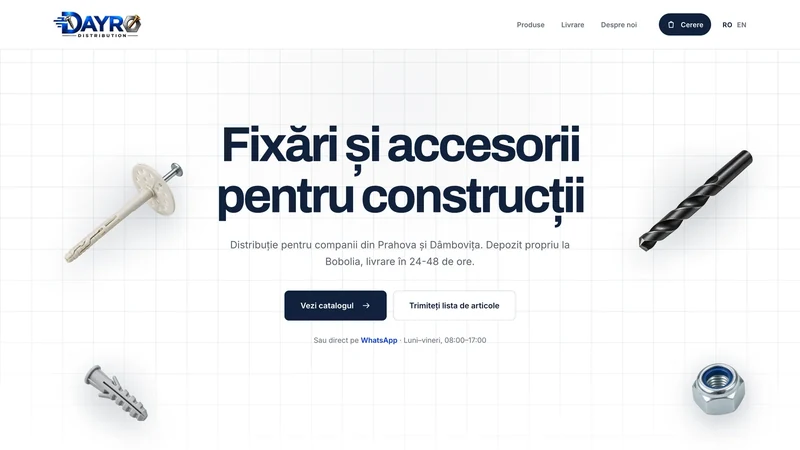

# Darius Șerban

I graduated in Computer Science in 2026, in Ploiești, Romania. I build web applications and run them on my own Linux server. My portfolio is [plainsite.dev](https://plainsite.dev/en/) and my email is serbdari98@gmail.com.

<table width="100%">
  <tr>
    <td align="center" width="50%">
      
       <b>Dayro Distribution website</b> Client work, live
    </td>
    <td align="center" width="50%">
      
       <b>LayerCure</b> Resin slicer in Rust, in progress
    </td>
  </tr>
  <tr>
    <td align="center" width="50%">
      
       <b>Workspace</b> Self-hosted tracker, in daily use
    </td>
    <td align="center" width="50%">
      
       <b>Ordering app for a field sales team</b> Client work, in beta, shown with demo data
    </td>
  </tr>
</table>

## Client work

Client repositories are private.

- **[Dayro Distribution website](https://dayrodistribution.com)**. I built and host this bilingual catalogue of 277 products for a Romanian distributor of construction fixings.
   Astro, React, TypeScript, Playwright, GitHub Actions
- **[Ordering app for a field sales team](https://plainsite.dev/en/projects/field-sales-ordering-app/)**. Sales agents take orders on their phones and the office approves them. The app reads the accounting database and never writes to it.
   TypeScript, Fastify, SQLite, Firebird, Kotlin, Vitest
- **Platform for youth sports clubs**. Two of us are building one system for clubs, coaches and parents, on the web and as Android and iOS apps.
   TypeScript, Express, Prisma, PostgreSQL, React, Capacitor

## My own projects

- **[dualspeakers](https://github.com/Fushi500/dualspeakers)**. It plays the same audio on two Windows outputs, with a measured median offset of -0.021 ms between them.
   C++20, WASAPI exclusive mode, CMake, 241 tests
- **[Workspace](https://plainsite.dev/en/projects/workspace/)**. I use this self-hosted tracker every day for pages, tables and boards.
   TypeScript, Fastify, React, PostgreSQL, Docker Compose
- **[LayerCure](https://plainsite.dev/en/projects/layercure/)**. I am building a resin 3D-printing slicer with a desktop app.
   Rust
- **[Macro Micro](https://plainsite.dev/en/projects/macro-micro/)**. Version 1 of this nutrition tracker was my bachelor thesis, and I am building version 2 as an Android app.
   Version 1 ran on Flutter, Fastify, PostgreSQL, Redis, Meilisearch and Docker Compose
- **[nutrition-label-llm](https://github.com/Fushi500/nutrition-label-llm)**. It is a LoRA fine-tune of Qwen2.5-14B that turns OCR text from EU nutrition labels into JSON.
   Python, Unsloth, TRL

I also keep [exercises-api](https://github.com/Fushi500/exercises-api), a static JSON API of 872 exercises, and [tourism-db](https://github.com/Fushi500/tourism-db), a MariaDB coursework schema.

## What I work with

<table width="100%">
  <tr>
    <td>
      <b>Languages</b> 
      
      
      
      
      
      
    </td>
  </tr>
  <tr>
    <td>
      <b>Web and apps</b> 
      
      
      
      
      
      
      
      
    </td>
  </tr>
  <tr>
    <td>
      <b>Data</b> 
      
      
      
      
      
      
      
    </td>
  </tr>
  <tr>
    <td>
      <b>Infrastructure and testing</b> 
      
      
      
      
      
      
      
    </td>
  </tr>
  <tr>
    <td>
      <b>AI</b> 
      
      
      
      
      
      
      
    </td>
  </tr>
</table>

## How I work

I build software by directing AI coding agents. I work in [T3 Code](https://github.com/pingdotgg/t3code) with Claude Code, Codex and Gemini, on my own Ubuntu server and a Mac mini. I set the goal and make the decisions. The agents write the code on a branch and open a pull request that says how they verified it. Models from other providers review the changes that carry risk. I approve every deploy, and I judge the result on the running product.
