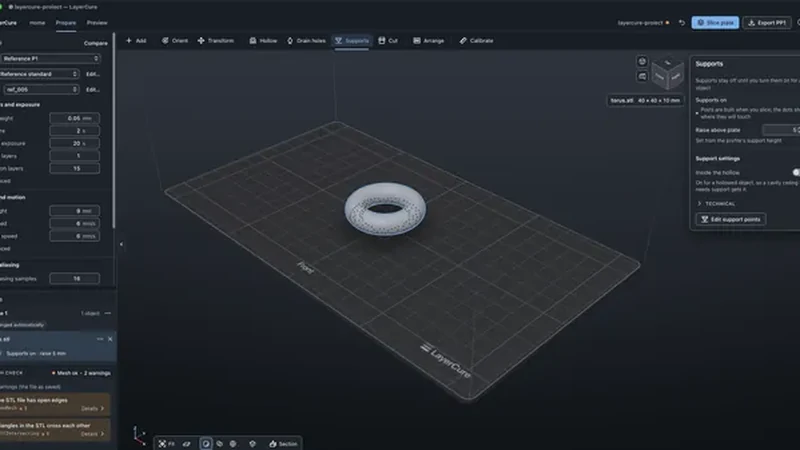
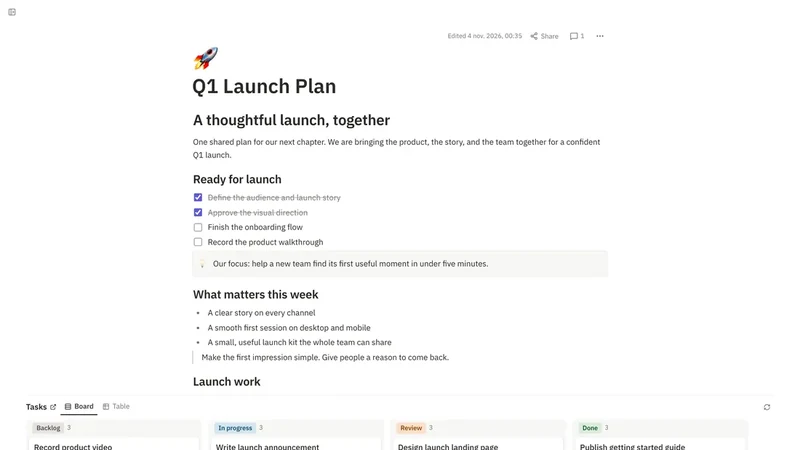

# Darius Șerban

Computer Science graduate (2026) from Ploiești, Romania. I build web applications and run them on my own Linux server.

The full write-up of every project is on my portfolio, **[plainsite.dev](https://plainsite.dev/en/)**. You can reach me at serbdari98@gmail.com.

<table width="100%">
  <tr>
    <td align="center" width="50%">
      
       <b>Dayro Distribution website</b> client work, live
    </td>
    <td align="center" width="50%">
      
       <b>LayerCure</b> resin slicer in Rust, in progress
    </td>
  </tr>
  <tr>
    <td align="center" width="50%">
      
       <b>Workspace</b> self-hosted tracker, in daily use
    </td>
    <td align="center" width="50%">
      
       <b>Ordering app for a field sales team</b> client work, beta, demo data
    </td>
  </tr>
</table>

## Client work

Client repositories are private.

- **[Dayro Distribution website](https://dayrodistribution.com)**. A bilingual catalogue and quote-request site for a Romanian distributor of construction fixings. It lists 277 products in 1,680 variants and shows whether each one is in stock. I host it on my own Ubuntu server. [Write-up](https://plainsite.dev/en/projects/dayro-distribution-website/)
   Astro, React, TypeScript, Playwright, GitHub Actions
- **[Ordering app for a field sales team](https://plainsite.dev/en/projects/field-sales-ordering-app/)** (beta). Sales agents take orders on their phones, the office approves them and exports XML for the accounting software. The app reads the accounting database and never writes to it.
   TypeScript, Fastify, SQLite, Firebird, Kotlin (Android WebView), Vitest
- **Platform for youth sports clubs** (in development, team of two). One system for clubs, coaches and parents, with teams, attendance, payments and invoices, on the web and as Android and iOS apps.
   TypeScript, Express, Prisma, PostgreSQL, React, Capacitor

## My own projects

- **[dualspeakers](https://github.com/Fushi500/dualspeakers)**. Plays the same audio on two Windows outputs and keeps them aligned. Measured with a microphone at the listening position, the median offset is -0.021 ms, with a spread of 0.203 ms over five runs. It works but is not finished.
   C++20, WASAPI exclusive mode, CMake, 241 tests
- **[Workspace](https://plainsite.dev/en/projects/workspace/)** (private, in daily use). A self-hosted tracker with pages, tables, boards, a command-line tool and an API.
   TypeScript, Fastify, React, PostgreSQL, Docker Compose
- **[LayerCure](https://plainsite.dev/en/projects/layercure/)** (in progress). A resin 3D-printing slicer with a desktop app.
   Rust
- **[Macro Micro](https://plainsite.dev/en/projects/macro-micro/)**. A nutrition and fitness tracker for Romania. Version 1 was the subject of my bachelor thesis and is now retired. I am rebuilding version 2 as an Android app.
   Version 1 ran on Flutter, Fastify, PostgreSQL, Redis, Meilisearch and Docker Compose
- **[nutrition-label-llm](https://github.com/Fushi500/nutrition-label-llm)**. A LoRA fine-tune of Qwen2.5-14B that turns OCR text from EU nutrition labels into JSON. The repository holds a synthetic dataset of 50,000 examples and the full QLoRA training pipeline.
   Python, Unsloth, TRL
- **Smaller ones**. [exercises-api](https://github.com/Fushi500/exercises-api), 872 exercises as static JSON on GitHub Pages, and [tourism-db](https://github.com/Fushi500/tourism-db), a MariaDB coursework schema.

## What I work with

<table width="100%">
  <tr>
    <td>
      <b>languages</b> 
      
      
      
      
      
      
    </td>
  </tr>
  <tr>
    <td>
      <b>web and apps</b> 
      
      
      
      
      
      
      
      
    </td>
  </tr>
  <tr>
    <td>
      <b>data</b> 
      
      
      
      
      
      
      
    </td>
  </tr>
  <tr>
    <td>
      <b>infra and testing</b> 
      
      
      
      
      
      
      
    </td>
  </tr>
  <tr>
    <td>
      <b>ai</b> 
      
      
      
      
    </td>
  </tr>
</table>

## How I work

- I run my own Ubuntu server with systemd services, Docker Compose and Cloudflare Tunnel.
- On client and larger projects, every change goes through a branch, a pull request and automated tests before it reaches `main`. The Dayro site has 31 merged pull requests. Small personal projects I commit directly.
- I use AI coding agents every day. I write the brief and the checks, read what they produce, and test the result on the real system before I call it done.
